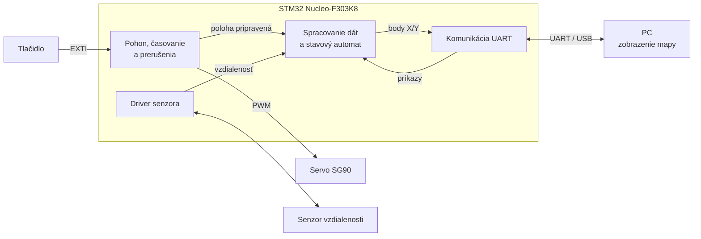

# Automatický 2D mapovač priestoru

Semestrálny projekt z predmetu **Vnorené riadiace systémy (VRS)**, FEI STU Bratislava.

**Tím:** Dzvoňár, Nebus, Ďurmek, Vozárik
**Platforma:** STM32 Nucleo-F303K8, firmvér v jazyku C (STM32CubeIDE)

---

## 1. Popis projektu

Zariadenie stojí na mieste a automaticky naskenuje priestor pred sebou v rozsahu **180°**. Senzor vzdialenosti je upevnený na serve. Mikrokontrolér otáča servom po krokoch a v každej polohe zmeria vzdialenosť k najbližšej prekážke. Namerané dáta STM32 filtruje a prepočíta na súradnice **X/Y**. Výsledok posiela cez **UART** do PC, kde sa body zobrazia ako **2D mapa** okolia (napr. rohu miestnosti alebo kartónového bludiska).

Prepočet bodu (uhol θ, vzdialenosť d, senzor je v počiatku súradníc):

```
x = d · cos(θ)
y = d · sin(θ)        θ ∈ ⟨0°, 180°⟩
```

### Funkcie

1. **Skenovanie 0°–180°** s nastaviteľným uhlovým krokom (1°–10°).
2. **Meranie vzdialenosti** v každej polohe, nastaviteľný počet meraní na jeden bod (1–9).
3. **Spracovanie dát priamo na STM32:**
   - odstránenie chybných meraní a filtrácia (medián z N meraní),
   - kalibrácia (offset senzora, korekcia uhla serva),
   - prepočet z polárnych súradníc (uhol, vzdialenosť) na karteziánske (X, Y).
4. **Komunikácia s PC cez UART:** zariadenie prijíma príkazy a odosiela namerané body (tabuľka príkazov v časti 4).
5. **Riadiaca logika:** stavový automat zariadenia (`IDLE`, `SCAN`, `SEND`, `ERROR`).
6. **Tlačidlo** na zariadení: štart skenu a núdzové zastavenie.
7. **Zobrazenie mapy na PC** z prijatých X/Y bodov.

### Bloková schéma



---

## 2. Merateľné ciele

| Parameter | Cieľová hodnota |
|-----------|-----------------|
| Rozsah skenu | 0°–180° |
| Uhlový krok | 1°–10°, predvolený 2° (91 bodov) |
| Trvanie skenu s krokom 2° a 3 meraniami na bod | ≤ 15 s |
| Merací rozsah | 5 cm – 150 cm |
| Chyba vzdialenosti po kalibrácii | ≤ ±2 cm v rozsahu 10–100 cm |
| Chyba uhla serva po kalibrácii | ≤ ±2° |
| Rovná stena vo vzdialenosti 1 m | na mape priamka s odchýlkou bodov ≤ ±3 cm |
| Reakcia na núdzové zastavenie tlačidlom | ≤ 20 ms |
| Spoľahlivosť prenosu | 10 skenov za sebou bez strateného bodu |

---

## 3. Zoznam HW

| # | Komponent | Ks | Účel |
|---|-----------|----|------|
| 1 | STM32 Nucleo-F303K8 | 1 | riadiaca jednotka |
| 2 | Senzor vzdialenosti: **upresníme** (laserový ToF VL53L0X/VL53L1X alebo ultrazvukový HC-SR04) | 1 | meranie vzdialenosti |
| 3 | Servo SG90 (0°–180°) | 1 | otáčanie senzorom |
| 4 | Tlačidlo | 1 | štart / núdzové zastavenie |
| 5 | Externý zdroj 5 V / 1 A (pre servo) + kondenzátor 470 µF | 1 | napájanie serva, potlačenie prúdových špičiek |
| 6 | Rezistory 1 kΩ + 2 kΩ (len pri HC-SR04) | 1 pár | delič napätia na Echo pin (5 V → 3,3 V) |
| 7 | Breadboard, prepojovacie vodiče | – | zapojenie |
| 8 | Držiak senzora na servo, podstavec (3D tlač / kartón / preglejka) | 1 | konštrukcia |
| 9 | USB kábel (UART cez ST-LINK virtuálny COM port) | 1 | komunikácia s PC |

---

## 4. Komunikačný protokol (UART)

Textové správy ukončené znakom `\n`, aby sa dali čítať aj v obyčajnom sériovom termináli. Za znakom `*` nasleduje kontrolný súčet: XOR všetkých znakov pred `*`, zapísaný ako 2 hex číslice.

### Príkazy PC → STM32

| Príkaz | Parameter | Popis |
|--------|-----------|-------|
| `START` | – | spustí sken |
| `STOP` | – | zastaví sken, servo ostane stáť |
| `STEP <n>` | 1–10 | uhlový krok v stupňoch |
| `SAMPLES <n>` | 1–9 | počet meraní na jeden bod (medián) |
| `GOTO <deg>` | 0–180 | natočí servo na uhol (ladenie, kalibrácia) |
| `CAL <mm>` | -100–100 | offset vzdialenosti senzora |
| `STATUS` | – | vráti aktuálny stav zariadenia |

Odpoveď na príkaz: `OK` alebo `ERR,<kód>`.

### Správy STM32 → PC

| Správa | Formát | Príklad |
|--------|--------|---------|
| Nameraný bod | `P,<uhol_deg>,<d_mm>,<x_mm>,<y_mm>` | `P,90,1000,0,1000*69` |
| Stav | `S,<stav>,<uhol_deg>` | `S,SCAN,46*4E` |
| Koniec skenu | `DONE,<počet_bodov>` | `DONE,91*24` |
| Chyba | `E,<kód>` | `E,2*5B` (timeout senzora) |

---

## 5. Rozdelenie úloh

Každý člen programuje jeden modul firmvéru v C, vrátane jeho otestovania a dokumentácie. `main.c` je spoločný.

### Dzvoňár: Pohon, časovanie a prerušenia
- Konfigurácia TIM2 na PWM 50 Hz pre servo, prepočet uhla na šírku impulzu, kalibrácia krajných polôh.
- Systémový tick cez prerušenie TIM6 (1 ms), neblokujúce časovače pre ostatné moduly.
- Riadenie skenu v prerušení: posun serva na ďalší uhol, odpočítanie času na ustálenie a nastavenie príznaku „poloha pripravená na meranie“.
- Tlačidlo cez externé prerušenie (EXTI): štart skenu a núdzové zastavenie, ošetrenie zákmitov (debounce) pomocou ticku.
- Konfigurácia NVIC: priority všetkých prerušení v systéme.
- **Súbory:** `servo.c/h`, `tick.c/h`, `scan.c/h`, `button.c/h`, `irq_config.c/h`

### Nebus: Driver senzora vzdialenosti
- Ovládač zvoleného senzora:
  - ToF: komunikácia cez I2C, inicializácia, spustenie a čítanie merania, kontrola statusu,
  - ultrazvuk: generovanie trigger impulzu, meranie dĺžky echo impulzu časovačom (input capture).
- Ošetrenie chýb (timeout, mimo rozsahu).
- Overenie presnosti na známych vzdialenostiach (10, 25, 50, 75, 100, 150 cm), výsledky v `docs/`.
- **Súbory:** `sensor.c/h` (spoločné API), `vl53l0x.c/h` alebo `hcsr04.c/h`

### Ďurmek: Komunikácia (UART)
- Konfigurácia USART2, príjem cez prerušenie do kruhového buffera.
- Parser príkazov a kontrolný súčet podľa protokolu v časti 4.
- Odosielanie nameraných bodov a stavových správ do PC.
- Ošetrenie chybných a neúplných správ.
- **Súbory:** `uart.c/h`, `ringbuf.c/h`, `protocol.c/h`

### Vozárik: Spracovanie dát a riadiaca logika
- Filtrácia meraní (medián z N meraní, odstránenie odľahlých hodnôt).
- Kalibrácia (offset vzdialenosti, korekcia uhla).
- Prepočet polárne → karteziánske súradnice (X, Y) a uloženie skenu do poľa.
- Hlavný stavový automat, ktorý prepája moduly ostatných (`IDLE` → `SCAN` → `SEND` → `IDLE`, `ERROR`).
- **Súbory:** `filter.c/h`, `calib.c/h`, `geometry.c/h`, `fsm.c/h`

### Spoločné úlohy (celý tím)
- Zapojenie HW, schéma zapojenia.
- Mechanická konštrukcia (držiak senzora, podstavec).
- Zobrazenie mapy na PC z dát z UART-u.
- Integrácia modulov a testovanie celého zariadenia podľa cieľov v časti 2.
- Dokumentácia v README.

---

## 6. Otvorené otázky

- Ktorý senzor vzdialenosti použijeme (laserový ToF VL53L0X/VL53L1X alebo ultrazvukový HC-SR04)?
- Máme periférie programovať na úrovni registrov, alebo môžeme použiť HAL knižnicu?
- Môže byť zobrazenie mapy na PC v inom jazyku ako C (napr. Python), alebo stačí hotový nástroj na zobrazenie sériových dát?
