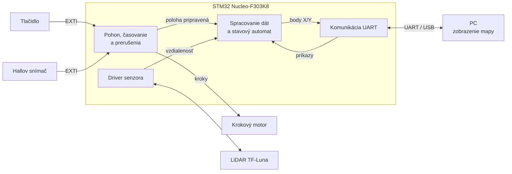

# Automatický 2D mapovač priestoru

Semestrálny projekt z predmetu **Vnorené riadiace systémy (VRS)**, FEI STU Bratislava.

**Tím:** Dzvoňár, Nebus, Ďurmek, Vozárik
**Platforma:** STM32 Nucleo-F303K8, firmvér v jazyku C (STM32CubeIDE)

---

## 1. Popis projektu

Zariadenie stojí na mieste a automaticky naskenuje priestor okolo seba v rozsahu **360°**. Cieľom je zmapovať miestnosť veľkosti laboratória, v ktorom prebiehajú cvičenia VRS. Na meranie vzdialenosti slúži laserový LiDAR senzor **TF-Luna** (dosah 0,2–8 m), upevnený na otočnej platforme s krokovým motorom. Po zapnutí zariadenie nájde nulovú polohu pomocou Hallovho snímača. Mikrokontrolér potom otáča platformou po krokoch a v každej polohe zmeria vzdialenosť k najbližšej prekážke. Namerané dáta STM32 filtruje a prepočíta na súradnice **X/Y**. Výsledok posiela cez **UART** do PC, kde sa body zobrazia ako **2D mapa** okolia. Zariadenie sa dá umiestniť kdekoľvek v miestnosti, napr. do stredu. Aby sa kábel senzora nezamotával, smer otáčania sa po každom skene strieda.

Prepočet bodu (uhol θ, vzdialenosť d, senzor je v počiatku súradníc):

```
x = d · cos(θ)
y = d · sin(θ)        θ ∈ ⟨0°, 360°)
```

### Funkcie

1. **Skenovanie 0°–360°** s nastaviteľným uhlovým krokom (1°–10°), nájdenie nulovej polohy (homing) po zapnutí.
2. **Meranie vzdialenosti** v každej polohe, nastaviteľný počet meraní na jeden bod (1–9).
3. **Spracovanie dát priamo na STM32:**
   - odstránenie chybných meraní a filtrácia (medián z N meraní),
   - kalibrácia (offset senzora, korekcia uhla),
   - prepočet z polárnych súradníc (uhol, vzdialenosť) na karteziánske (X, Y).
4. **Komunikácia s PC cez UART:** zariadenie prijíma príkazy a odosiela namerané body (tabuľka príkazov v časti 4).
5. **Riadiaca logika:** stavový automat zariadenia (`IDLE`, `SCAN`, `SEND`, `ERROR`).
6. **Tlačidlo** na zariadení: štart skenu a núdzové zastavenie.
7. **Zobrazenie mapy na PC** z prijatých X/Y bodov.

### Bloková schéma



---

## 2. Merateľné ciele

| Parameter | Cieľová hodnota |
|-----------|-----------------|
| Rozsah skenu | 0°–360° |
| Uhlový krok | 1°–10°, predvolený 2° (180 bodov) |
| Trvanie skenu s krokom 2° a 3 meraniami na bod | ≤ 30 s |
| Mapovaný priestor | miestnosť veľkosti laboratória VRS |
| Merací rozsah | 0,2 m – 8 m |
| Chyba vzdialenosti po kalibrácii | ≤ ±6 cm do 3 m, ≤ 2 % nad 3 m |
| Chyba uhla po kalibrácii | ≤ ±2° |
| Opakovateľnosť nulovej polohy (homing) | ≤ ±1° |
| Rovná stena vo vzdialenosti 3 m | na mape priamka s odchýlkou bodov ≤ ±10 cm |
| Reakcia na núdzové zastavenie tlačidlom | ≤ 20 ms |
| Spoľahlivosť prenosu | 10 skenov za sebou bez strateného bodu |

---

## 3. Zoznam HW

| # | Komponent | Ks | Účel |
|---|-----------|----|------|
| 1 | STM32 Nucleo-F303K8 | 1 | riadiaca jednotka |
| 2 | LiDAR senzor TF-Luna (0,2–8 m, UART / I2C) | 1 | meranie vzdialenosti |
| 3 | Krokový motor 28BYJ-48 (5 V) + budič ULN2003 | 1 | otáčanie platformou so senzorom |
| 4 | Hallov snímač A3144 + magnet | 1 | nulová poloha (homing) |
| 5 | Tlačidlo | 1 | štart / núdzové zastavenie |
| 6 | Externý zdroj 5 V / 1 A + kondenzátor 470 µF | 1 | napájanie motora a senzora, potlačenie prúdových špičiek |
| 7 | Breadboard, prepojovacie vodiče | – | zapojenie |
| 8 | Otočná platforma s držiakom senzora, podstavec (3D tlač / kartón / preglejka) | 1 | konštrukcia |
| 9 | USB kábel (UART cez ST-LINK virtuálny COM port) | 1 | komunikácia s PC |

---

## 4. Komunikačný protokol (UART)

Textové správy ukončené znakom `\n`, aby sa dali čítať aj v obyčajnom sériovom termináli. Za znakom `*` nasleduje kontrolný súčet: XOR všetkých znakov pred `*`, zapísaný ako 2 hex číslice.

### Príkazy PC → STM32

| Príkaz | Parameter | Popis |
|--------|-----------|-------|
| `START` | – | spustí sken |
| `STOP` | – | zastaví sken, motor ostane stáť |
| `STEP <n>` | 1–10 | uhlový krok v stupňoch |
| `SAMPLES <n>` | 1–9 | počet meraní na jeden bod (medián) |
| `GOTO <deg>` | 0–359 | natočí platformu na uhol (ladenie, kalibrácia) |
| `CAL <mm>` | -100–100 | offset vzdialenosti senzora |
| `STATUS` | – | vráti aktuálny stav zariadenia |

Odpoveď na príkaz: `OK` alebo `ERR,<kód>`.

### Správy STM32 → PC

| Správa | Formát | Príklad |
|--------|--------|---------|
| Nameraný bod | `P,<uhol_deg>,<d_mm>,<x_mm>,<y_mm>` | `P,90,1000,0,1000*69` |
| Stav | `S,<stav>,<uhol_deg>` | `S,SCAN,46*4E` |
| Koniec skenu | `DONE,<počet_bodov>` | `DONE,91*24` |
| Chyba | `E,<kód>` | `E,2*5B` (timeout senzora) |

---

## 5. Rozdelenie úloh

Firmvér bude implementovaný v jazyku C s využitím knižnice HAL.

### Dzvoňár: Pohon, časovanie a prerušenia
- Riadenie krokového motora (generovanie krokov pomocou časovača a prerušení).
- Nájdenie nulovej polohy (homing) pomocou Hallovho snímača a externého prerušenia.
- Návrh časovej základne systému a neblokujúceho časovania pre ostatné moduly.
- Riadenie priebehu skenovania pomocou prerušení.
- Obsluha tlačidla pomocou externého prerušenia (štart, núdzové zastavenie).
- Návrh a zdôvodnenie priorít prerušení v systéme.

### Nebus: Senzor vzdialenosti a mechanická konštrukcia
- Ovládač senzora TF-Luna (inicializácia, čítanie merania, kontrola sily signálu a stavu).
- Ošetrenie chýb merania (timeout, hodnota mimo rozsahu, slabý odraz).
- Overenie presnosti senzora na známych vzdialenostiach.
- Mechanická konštrukcia (otočná platforma s držiakom senzora, podstavec).

### Ďurmek: Komunikácia a zobrazenie mapy
- Komunikácia s PC cez UART s príjmom pomocou prerušení.
- Spracovanie príkazov z PC a odosielanie nameraných dát podľa protokolu v časti 4.
- Ošetrenie chybných a neúplných správ.
- Zobrazenie mapy na PC z prijatých dát.

### Vozárik: Spracovanie dát a riadiaca logika
- Filtrácia meraní a odstránenie chybných hodnôt.
- Kalibrácia (offset vzdialenosti, korekcia uhla).
- Prepočet nameraných dát na súradnice X, Y a uloženie skenu.
- Hlavný stavový automat, ktorý prepája moduly ostatných členov.

---

## 6. Otvorené otázky

- Môže byť zobrazenie mapy na PC v inom jazyku ako C (napr. Python), alebo stačí hotový nástroj na zobrazenie sériových dát?
